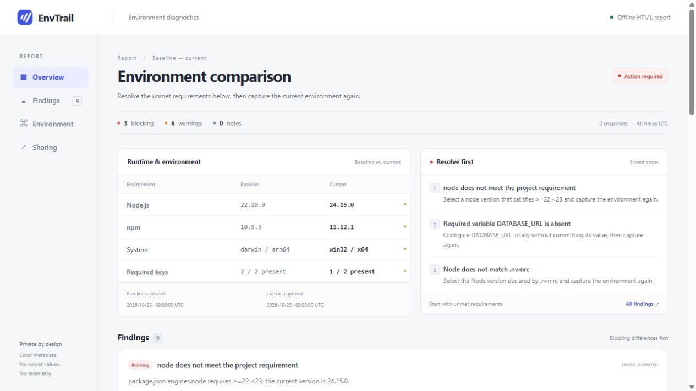

# 

**“내 컴퓨터에서는 되는데?”를 개발 환경 비교로 좁혀 보세요.**

[](https://github.com/YHS-Sec/envtrail/actions/workflows/ci.yml)
[](LICENSE)
[](https://nodejs.org/)

[English](README.md) · [예시 리포트 보기](https://yhs-sec.github.io/envtrail/) · [개인정보 처리 범위](docs/privacy.md) · [기여 안내](CONTRIBUTING.md)

EnvTrail은 Node.js 프로젝트의 개발 환경을 비교하는 로컬 CLI입니다. 정상 동작하는 환경을 저장한 뒤 다른 환경과 비교해 버전 차이, 프로젝트 요구사항, 누락된 환경변수를 확인합니다.

가입, 업로드, 백그라운드 서비스가 필요하지 않습니다. 환경변수의 **실제 값은 스냅샷과 리포트에 저장하지 않습니다**.



_가상 환경을 사용한 비교 예시입니다._

## 시작하기

Node.js 22 이상과 npm이 필요합니다. GitHub 첫 릴리스에 첨부된 패키지를 설치하세요.

```sh
npm install -g https://github.com/YHS-Sec/envtrail/releases/download/v0.1.0/yhs-sec-envtrail-0.1.0.tgz
envtrail --help
```

패키지는 GitHub Releases를 통해 배포합니다. npm 레지스트리에는 아직 게시하지 않았습니다.

### 소스에서 실행하기

소스를 직접 확인하거나 수정하려면 다음 명령을 사용하세요.

```sh
git clone https://github.com/YHS-Sec/envtrail.git
cd envtrail
npm ci
npm run build
node dist/cli.js --help
```

아래 예시는 설치된 `envtrail` 명령을 사용합니다. 소스로 실행한다면 `node /path/to/envtrail/dist/cli.js`로 바꿔 사용하세요.

### 두 컴퓨터 비교하기

정상 동작하는 컴퓨터에서 기준 환경을 저장합니다.

```sh
envtrail capture --project /path/to/my-app --output baseline.json
```

내용을 확인한 `baseline.json`을 전달한 뒤, 다른 컴퓨터에서 같은 프로젝트를 비교합니다.

```sh
envtrail compare baseline.json --project /path/to/my-app --html report.html
```

현재 환경을 새로 수집하지 않고 저장된 두 파일만 비교할 수도 있습니다.

```sh
envtrail capture --project /path/to/my-app --output current.json
envtrail compare baseline.json current.json --html report.html
```

`report.html`을 브라우저로 열면 결과를 확인할 수 있습니다. 리포트는 독립된 HTML 파일입니다.

> 위 경로는 예시입니다. PowerShell에서는 `C:\work\my-app`처럼 실제 프로젝트 경로를 사용하세요. 프로젝트 폴더 안에서 실행하면 `--project`를 생략할 수 있습니다.

## 자주 쓰는 명령

```sh
# 저장한 환경 확인
envtrail inspect baseline.json

# 자동 처리용 JSON 비교 결과 저장
envtrail compare baseline.json current.json --json --output comparison.json

# 경고나 오류가 있으면 CI를 실패 처리
envtrail compare baseline.json current.json --fail-on warning
```

`--fail-on`은 `error`, `warning`, `never`를 지원합니다. 기본값은 `never`이며, 비교 결과만으로 명령이 실패하지 않습니다. 잘못된 입력이나 실행 오류는 기본값과 관계없이 실패합니다.

`capture`는 `--output`이 없으면 JSON을 표준 출력으로 보냅니다. 기존 파일은 기본적으로 덮어쓰지 않으며, 의도적으로 교체할 때는 `--force`를 사용하세요. 비교 결과로 입력 스냅샷을 덮어쓸 수는 없습니다.

## 확인할 수 있는 것

- Node.js와 시스템에서 탐지한 npm, pnpm, Yarn, Bun의 버전 차이.
- `package.json`의 `engines`·`packageManager`, `.nvmrc`, `.node-version`에 선언된 요구사항.
- 원문이나 의존성 목록을 저장하지 않는 lockfile 지문 비교.
- `.env.example`, `.env.sample`, `.env.template`에 선언된 변수 이름과 프로세스 환경·로컬 `.env` 파일에서의 존재 여부.
- 터미널, JSON, HTML로 검토할 수 있는 비교 결과.

EnvTrail은 의존성을 설치하거나 패키지 스크립트를 실행하지 않으며, 개발 환경을 변경하지 않습니다. 지원하는 프로젝트 설정 파일을 읽고, 지원 도구의 버전 정보를 확인합니다. 환경변수 값은 스냅샷에 저장하지 않습니다.

## 결과 해석하기

환경 차이는 원인을 찾기 위한 단서입니다. 버전이 달라도 두 버전 모두 요구사항을 만족할 수 있습니다. 빈 값을 할당한 환경변수도 존재하는 것으로 처리하며, 존재 여부만으로 값이나 인증정보의 유효성을 알 수 없습니다. 두 스냅샷이 같아도 네트워크, 권한, 외부 서비스, 네이티브 의존성, 애플리케이션 버그는 별도로 확인해야 합니다.

패키지 관리자 버전은 시스템 도구를 오프라인으로 확인한 결과입니다. 프로젝트가 선택하는 Corepack 버전이나 Yarn의 `yarnPath` 코드는 실행하지 않습니다. 프로젝트에서 실제 사용하는 버전이 다를 수 있으므로 패키지 관리자 요구사항 불일치는 경고로 표시합니다. 버전을 탐지하지 못해도 미설치로 단정하지 않습니다. 확인된 Node.js 요구사항 위반과 선언된 환경변수 누락은 오류로 표시합니다.

프로젝트 요구사항 위반부터 확인한 뒤 관련 있는 차이를 조사하세요. 자세한 사용법은 [워크플로 가이드](docs/usage.md), 공유 전 확인사항은 [개인정보 처리 범위](docs/privacy.md)를 참고하세요.

## 개발 및 기여

```sh
npm ci
npm run check
npm run smoke:package
npm run demo
```

`npm run check`는 타입 검사, 테스트, 빌드, 포맷 검사를 실행합니다. 테스트만 실행하려면 `npm test`를 사용하세요. 기여 방법은 [CONTRIBUTING.md](CONTRIBUTING.md), 구현 구조는 [architecture](docs/architecture.md)를 참고하세요.

첫 버전은 Node.js 프로젝트를 대상으로 합니다. [변경 내역](CHANGELOG.md)을 확인하거나, [버그·기능 제안](https://github.com/YHS-Sec/envtrail/issues/new/choose)을 남겨 주세요. 민감한 보안 제보는 [보안 정책](SECURITY.md)에 따라 전달해 주세요.

## 라이선스

[MIT](LICENSE) © 2026 YHS-Sec.
